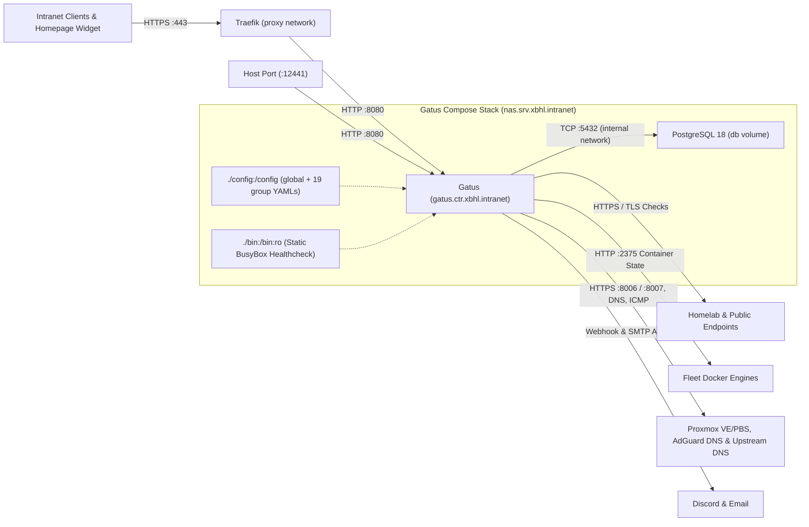

# Gatus

> Version: `v5.38.0` | Images: `ghcr.io/twin/gatus:v5.38.0`, `postgres:18.6` | Upstream: https://github.com/TwiN/gatus

Automated fleet health, certificate expiration, DNS, ICMP, and Docker container state monitor backed by PostgreSQL persistence and Discord/SMTP alerting.

## Service Overview

| Property | Value |
| :--- | :--- |
| **Domain** | `status.intranet.xbhl.online` (plus host port `12441:8080` on `nas.srv.xbhl.intranet`) |
| **Primary Node** | `nas.srv.xbhl.intranet` (`Physical QNAP Server`) |
| **Deploy Path** | `/share/Container/services/gatus` |
| **Ingress Strategy** | Intranet TLS via Traefik (`websecure` -> `gatus:8080` on external `proxy` network; Cloudflare DNS `direct`) + published host port `12441:8080` |
| **Topology Archetype** | Centralized Fleet Health Monitor (`gatus` + `postgres` sidecar) |
| **Authentication** | None (publicly readable intranet status dashboard without Authelia middleware or Gatus `security:` block) |
| **Ecosystem** | WUD tracks `gatus` (`^v\d+\.\d+\.\d+$`; `postgres` sidecar unlabelled); Homepage `Infrastructure` tile (`server: nas`, `container: gatus`, `gatus` widget polling `https://status.intranet.xbhl.online`); monitors 19 service/infrastructure groups in `src/config/*.yaml` (no self-monitoring `gatus.yaml` endpoint); no Authelia OIDC |

## Architecture & Communication

- **Container & Network Layout**: `gatus` (`gatus.ctr.xbhl.intranet`) joins both the external `proxy` network (for Traefik routing on `status.intranet.xbhl.online`) and the internal `internal` bridge network shared exclusively with the `postgres` sidecar (`depends_on: condition: service_healthy`). PostgreSQL persists check history and events (`caching: true`, `maximum-number-of-results: 100`, `maximum-number-of-events: 50`) in the local named volume `db:/var/lib/postgresql`.
- **Static BusyBox Healthcheck Injection**: Because the upstream `ghcr.io/twin/gatus` image is built `FROM scratch` without `/bin/sh` or `wget`, `.gitlab-ci.yml` (`setup:generate-build-artifacts`) downloads a static musl `busybox` binary into `$BUILD_ARTIFACTS_DIR/bin/busybox`, mounted read-only at `./bin:/bin:ro` so Docker can execute `["CMD", "/bin/busybox", "wget", "--quiet", "--spider", "http://127.0.0.1:8080/health"]`. Prometheus metrics are enabled via `metrics: true` in `src/config/global.yaml`.
- **Per-Group Configuration & Onboarding (`src/config/*.yaml`)**: `GATUS_CONFIG_PATH=/config` merges `src/config/global.yaml` (UI settings, PostgreSQL storage, and Discord/email default alerts with failure thresholds `5` and `10`, success threshold `3`, `send-on-resolved: true`) with 19 per-group files (`adguard`, `authelia`, `bookorbit`, `gitlab`, `grafana`, `homepage`, `internet-access`, `litellm`, `llama-cpp`, `nextcloud`, `open-webui`, `portainer`, `proxmox`, `qbittorrent`, `searxng`, `seerr`, `tautulli`, `traefik`, `whats-up-docker`).
  - **Docker Service Onboarding ([`.agents/skills/add-service/SKILL.md`](./.agents/skills/add-service/SKILL.md))**: Standard service groups pair external HTTPS checks (`<component>-<type>-status`, carrying `alerts: *alerts` and `[CERTIFICATE_EXPIRATION] > 48h`) with a silent runtime container state check (`<component>-container-status` polling `http://<vm_hostname>:2375/containers/<container_name>/json` without `alerts`). Agents derive `vm-hostname`, `container-name`, `cloudflare-dns-entry-name`, and `healthcheck` statically from the target repo's `.gitlab-ci.yml` and `src/docker-compose.yml` (never probing `:2375` at agent-time), wire any required token into `src/env/service-tokens.env` + `.gitlab-ci.yml`, and open a `feat/<service>-monitoring` Merge Request to be merged **after** the target service deploys.
  - **Hand-Maintained Infrastructure Groups**: `proxmox.yaml` (direct PVE `:8006` and PBS `:8007` API checks), DNS `A`/`CNAME` checks at the top of `adguard.yaml`, and ICMP/HTTPS reachability probes in `internet-access.yaml` are maintained outside automated container discovery.

## Required GitLab CI/CD Variables

### Project-Scoped Variables (`home-lab/gatus`)

| Variable | Target File (`setup:generate-build-artifacts`) | Purpose |
| :--- | :--- | :--- |
| `DISCORD_WEBHOOK_URL` | `env/discord.env` | Discord webhook URL for endpoint outage/recovery alerts (`src/config/global.yaml`; project-level override of group variable). |
| `GITLAB_STATUS_TOKEN` | `env/service-tokens.env` | Query token (`?token=...`) for GitLab `/-/liveness` and `/-/readiness` checks (`src/config/gitlab.yaml`). |
| `OPEN_WEBUI_AUTH_TOKEN` | `env/service-tokens.env` | Bearer token for authenticated `/api/models` readiness probe (`src/config/open-webui.yaml`). |
| `TAUTULLI_API_KEY` | `env/service-tokens.env` | API key (`?apikey=...&cmd=status`) for Tautulli `/api/v2` check (`src/config/tautulli.yaml`). |
| `PVE_TOKEN_ID`, `PVE_TOKEN_SECRET` | `env/service-tokens.env` (`PVE_API_TOKEN`) | Assembled as `${PVE_TOKEN_ID}=${PVE_TOKEN_SECRET}` (`=` delimiter) for `PVEAPIToken` headers (`src/config/proxmox.yaml`). |
| `PBS_TOKEN_ID`, `PBS_TOKEN_SECRET` | `env/service-tokens.env` (`PBS_API_TOKEN`) | Assembled as `${PBS_TOKEN_ID}:${PBS_TOKEN_SECRET}` (`:` delimiter) for `PBSAPIToken` headers (`src/config/proxmox.yaml`). |

### Group-Inherited Variables (`home-lab`)

| Variable | Target / Consumer | Purpose |
| :--- | :--- | :--- |
| `SSH_USER`, `SSH_PRIVATE_KEY` | `docker-compose-service-deployment` | SSH deployment credentials for `nas.srv.xbhl.intranet`. |
| `CLOUDFLARE_ZONE_ID`, `CLOUDFLARE_DNS_API_TOKEN` | `docker-compose-service-deployment` & `env/gatus.env` | Manages `status.intranet.xbhl.online` DNS record (`SERVICE_HOSTNAME`, also substituted into `GATUS_DOMAIN`). |
| `SMTP_HOST`, `SMTP_PORT`, `SMTP_USERNAME`, `SMTP_PASSWORD`, `SMTP_FROM`, `SMTP_TO` | `env/smtp.env` | Outbound SMTP credentials and sender/recipient addresses for email alerts (`src/config/global.yaml`). |

*(Note: `src/env/db.env` sets `POSTGRES_DB=gatus`, `POSTGRES_USER=gatus`, and a static `POSTGRES_PASSWORD` committed directly in Git without CI/CD substitution.)*

## Upgrades & Maintenance

- **Upstream & Wrapper Sources**: Standard (tracked via `wud.link.template`); configuration and condition schema reference at <https://gatus.io/docs> (`GATUS_CONFIG_PATH=/config` merges `src/config/global.yaml` with all per-group `src/config/<group>.yaml` files).
- **Version & Flavor Constraints**: `ghcr.io/twin/gatus` `v`-prefixed SemVer tags (`wud.tag.include=^v\d+\.\d+\.\d+$$`; upstream `Dockerfile` is `FROM scratch` with no shell or `wget`); `postgres` sidecar runs PostgreSQL 18 with local named volume `db:/var/lib/postgresql` (currently unlabelled for WUD).
- **Intentional Choices (Do Not Propose)**: Publicly readable intranet status UI (`status.intranet.xbhl.online` and host port `12441:8080` without Authelia middleware or `security:` block); `*-container-status` endpoints in `src/config/*.yaml` poll `http://<vm_hostname>:2375/containers/<name>/json` without `alerts: *alerts` to avoid duplicate notifications alongside external HTTPS checks; `proxmox.yaml` uses `client.insecure: true` on direct node ports `:8006`/`:8007`.
- **Upgrade & CI Gotchas**: Uses singular `src/env/*.env` (not `src/envs/`), with `src/env/db.env` copied untouched (`POSTGRES_PASSWORD` is static in Git) and `PVE_API_TOKEN` formatted with `=` (`ID=SECRET`) vs `PBS_API_TOKEN` with `:` (`ID:SECRET`) in `setup:generate-build-artifacts`; CI downloads a static musl `busybox` into `$BUILD_ARTIFACTS_DIR/bin/busybox` (`./bin:/bin:ro`) for the container `healthcheck`, and `delete-existing-container-files: true` relies on PostgreSQL using named volume `db` rather than a bind mount; renaming `group` or endpoint `name` in `src/config/*.yaml` drops historical PostgreSQL uptime data; `.agents/skills/add-service/SKILL.md` derives target service metadata statically from GitLab/repo files (never probe `:2375` at agent-time) and opens MRs that merge only after the target service deploys.
