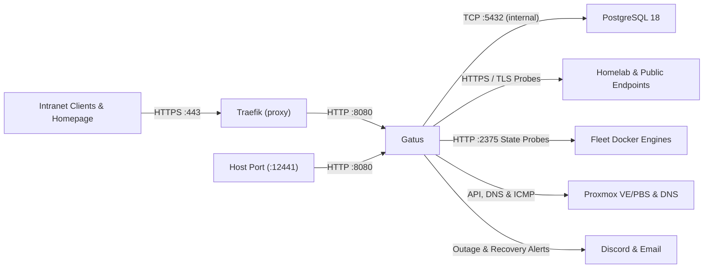

# Gatus

> Version: `v5.38.0` | Images: `ghcr.io/twin/gatus:v5.38.0`, `postgres:18.6` | Upstream: https://github.com/TwiN/gatus

Automated homelab health, TLS certificate expiration, DNS, ICMP, and Docker container state monitor backed by PostgreSQL persistence and Discord/email alerting.

## Overview

| Property | Value |
| :--- | :--- |
| **Domain** | `status.intranet.xbhl.online` (plus host port `12441:8080`) |
| **Node** | `nas.srv.xbhl.intranet` |
| **Ingress** | Intranet TLS via Traefik (`proxy` network) and direct host port `:12441` |
| **Authentication** | None (publicly readable intranet status dashboard) |
| **Ecosystem** | WUD SemVer tracking (`gatus`), Homepage status widget, Prometheus `/metrics`, Discord & email alerts |

## Architecture & Key Decisions

- **Unauthenticated Intranet Access & Dual Reachability**: Exposes the status dashboard and Prometheus `/metrics` without Authelia middleware or a Gatus `security:` block so Homepage widgets and operators can reach `status.intranet.xbhl.online` (or fallback host port `:12441` during ingress/DNS incidents); PostgreSQL 18 runs on an isolated `internal` bridge network to persist check history and events.
- **Paired Ingress vs. Silent Container State Probes**: Service groups pair external HTTPS checks (`<component>-<type>-status`, enforcing `[CERTIFICATE_EXPIRATION] > 48h` and routing `alerts: *alerts`) with silent Docker Engine checks (`<component>-container-status` polling `<vm_hostname>:2375` without `alerts`) to separate ingress/TLS failures from unhealthy containers without duplicate alert noise.
- **Static BusyBox Healthcheck Injection**: Because upstream `ghcr.io/twin/gatus` is built `FROM scratch` without a shell or `wget`, CI bundles a static musl `busybox` binary so Docker can probe `http://127.0.0.1:8080/health` locally.
- **Modular Per-Group Configuration**: `GATUS_CONFIG_PATH=/config` merges `src/config/global.yaml` with per-group `src/config/<group>.yaml` files, combining agent-managed Docker service checks ([`.agents/skills/manage-endpoints/SKILL.md`](./.agents/skills/manage-endpoints/SKILL.md)) with hand-maintained infrastructure probes (`proxmox.yaml`, DNS queries in `adguard.yaml`, and external reachability in `internet-access.yaml`).

### External Credentials

- **Discord Webhook**: Project-scoped `DISCORD_WEBHOOK_URL` configures the Discord channel webhook for outage and recovery notifications.
- **Proxmox API Tokens**: `PVE_TOKEN_ID` / `PVE_TOKEN_SECRET` and `PBS_TOKEN_ID` / `PBS_TOKEN_SECRET` authenticate direct Proxmox VE (`:8006`) and Proxmox Backup Server (`:8007`) API probes.
- **Monitored Application Tokens**: Upstream service tokens (`GITLAB_STATUS_TOKEN`, `OPEN_WEBUI_AUTH_TOKEN`, `TAUTULLI_API_KEY`, and `*_MONITORING_TOKEN` entries in `service-tokens.env`) authenticate protected health/readiness endpoints.

## Upgrades & Maintenance

- **Upstream & Wrapper Sources**: Tracked via `wud.link.template`; configuration and condition schema reference at <https://gatus.io/docs>, with endpoint lifecycle workflows in [`.agents/skills/manage-endpoints/SKILL.md`](./.agents/skills/manage-endpoints/SKILL.md).
- **Version & Flavor Constraints**: `ghcr.io/twin/gatus` uses `v`-prefixed SemVer tags (`^v\d+\.\d+\.\d+$$`, `FROM scratch` image); the `postgres` sidecar tracks PostgreSQL 18 (unlabelled in WUD).
- **Intentional Choices (Do Not Propose)**: Unauthenticated intranet UI on `status.intranet.xbhl.online` and `:12441`; silent `*-container-status` `:2375` probes without `alerts: *alerts`; `client.insecure: true` on direct Proxmox `:8006`/`:8007` checks.
- **Upgrade & CI Gotchas**: Uses singular `src/env/` (not `src/envs/`); `setup:generate-build-artifacts` assembles `PVE_API_TOKEN` with `=` (`ID=SECRET`) vs. `PBS_API_TOKEN` with `:` (`ID:SECRET`) and downloads static musl `busybox` for the `FROM scratch` healthcheck; renaming `group` or endpoint `name` in `src/config/*.yaml` drops PostgreSQL uptime history; new service monitoring MRs must merge only **after** the target service deploys.
